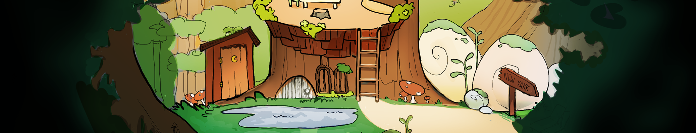

# 
Lillie 🌿

**Lillie** is a bespoke, multi-purpose Discord bot specifically created for [Brown RISD Game Developers](https://brownrisd.games/).

### Core features:

- Managing Brown/RISD student verification 🎫
- Tracking skill points for peer-to-peer interactions 🗝️

At this time, Lillie is a privately-hosted bot, and is not for public use.

We encourage you to self-host and customize your own version if you would like, or reach out to the [BRGD E-Board](https://brownrisd.games/team) at [brgd@brown.edu](mailto:brgd@brown.edu) to inquire about using Lillie for your own server.
